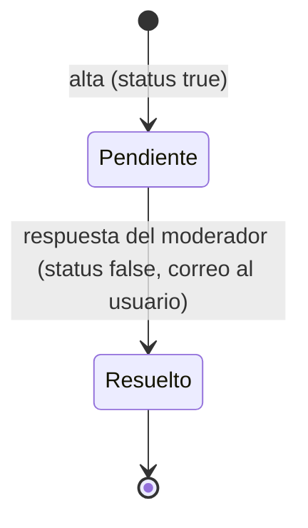
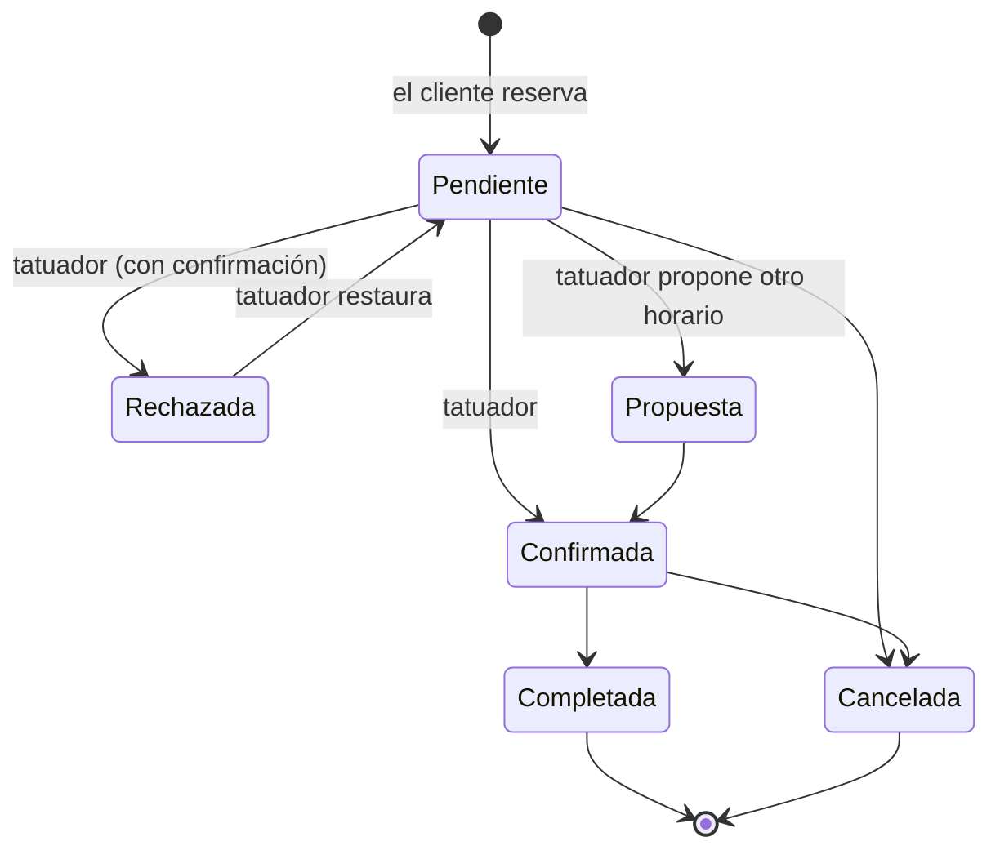

# Estados

## Ticket de soporte

En el servidor, `status: true` es abierto.

## Turno

Regla del servidor: un turno Completado o Cancelado ya no cambia; entre los demás, el tatuador puede ir y volver.

